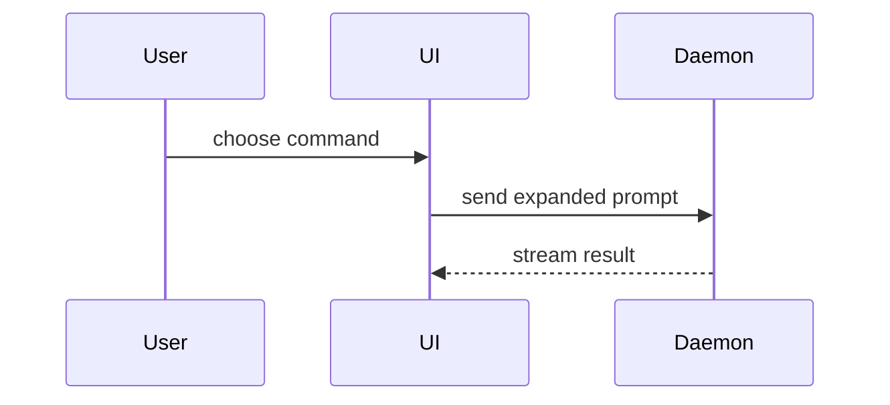

Help the user understand the current topic of conversation visually. Skip the preamble and keep prose brief. Pick the
smallest view that makes the key point clear.

When another skill or workflow names the view shape, use that shape directly. Skip shape selection and any HTML-artifact
option; keep the output within the caller's requested scope and format.

- Show logic or an algorithm as pseudocode:

```text
on(save)
  if content is unchanged
    return cached result
  write new content
  return fresh result
```

- Show runtime control flow as a call tree:

```text
submitForm
  createSession
    persistPrompt
    launchAgent
  navigateToSession
```

- Show UI structure as a component tree, including state and module boundaries that matter:

```tsx
<SessionPage> (apps/example/src/routes/session.tsx)
  useSessionEvents()
  <SessionToolbar>
    <RunSkillButton> (packages/ui)
```

- Show an exported API or interface change as an API-surface diff, grouped by file. Include only changed exported
  symbols or signatures, with additions, removals, and replacements explicit:

```diff
 internal/api/suggestion.go
-ApplySuggestion(client, prNumber, commentID)
+ApplySuggestion(client, target SuggestionTarget)
+
 internal/api/types.go
 type SuggestionTarget struct {
+  PullRequest int
+  CommentID   int
 }
```

- Show file responsibility or a broad refactor as a shallow file tree:

```text
src/
├── commands/       # parses user actions
├── sessions/       # owns session state
└── transport/      # sends API requests
```

- Show component interaction, control flow, or data flow with Mermaid. When the topic involves branching workflows,
  state transitions, domain or data relationships, architecture, dependencies, or deployment topology, read
  [Mermaid diagram types](references/diagram-types.md) and choose the matching shape. Stay within flowchart,
  sequence, state, class, and ER: those are the kinds terminal renderers draw. Keep a diagram under 120 columns
  wide with short labels and few nodes; a wider one is replaced by a notice in the terminal. On a surface that
  shows fenced Mermaid as raw text, prefer the call tree or pseudocode shape and say the diagram was downgraded.

  Use a sequence diagram when the order of interactions over time is the point:



- Use `diff` when the point is what changes and the surrounding shape already exists. Match the diff shape to the topic.

For a component change:

```diff
 <SessionPage>
   useSessionEvents()
   <SessionToolbar>
+    <RunSkillButton />
   <SessionTimeline>
+    <SkillResultCard />
```

For a file-layout change:

```diff
 src/
 ├── commands/
+│   └── show-me.ts       # expands the slash command
 ├── sessions/
-└── transport.ts
+└── transport/
+    ├── client.ts
+    └── stream.ts
```

For a call-tree or call-stack change:

```diff
 submitForm
   createSession
     persistPrompt
+    expandSkillMention
     launchAgent
-  navigateToSession
+  navigateToSession
+    subscribeToEvents
```

For a state or control-flow change:

```diff
 on(save)
-  write content
+  if content is unchanged
+    return cached result
+  write new content
+  invalidate cache
```

- Show the whole block when most of it is new, when omitted context would hide ownership or order, or when the user
  needs a copyable target shape:

```ts
function expandSkill(command: string): string {
  const skillName = command.slice(1)
  return `use the ${skillName} skill`
}
```

- For a visual UI, layout, state comparison, or concept too dense for Mermaid, write one focused HTML file — a diagram,
  an infographic, or a short slide deck, whichever fits the point. Match the product's colors, type, spacing, and
  components; use real labels and data; support desktop and mobile. On a local terminal open it with the platform
  opener; on a hosted surface publish it as an artifact and give the link:

```text
Bash(open path/to/show-me-{description}.html)
```

### guidance

Place each visual next to the short text it supports. Keep only the calls, files, props, states, and boundaries needed
to answer the user's current question or the options to resolve the current discussion point.

You may use one of these, you may use several, it is unlikely you will use all of them. Use your judgement and don't
overwhelm the user.
