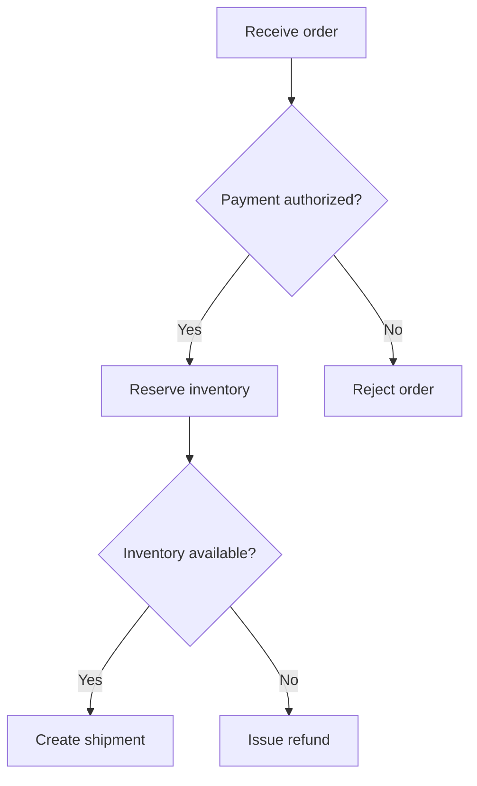
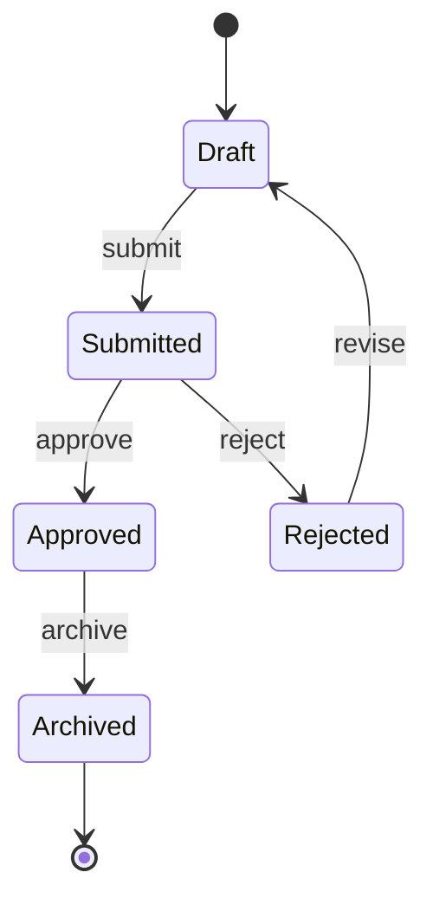
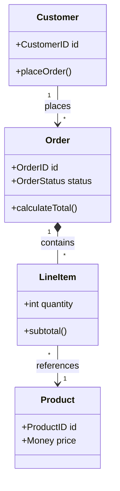
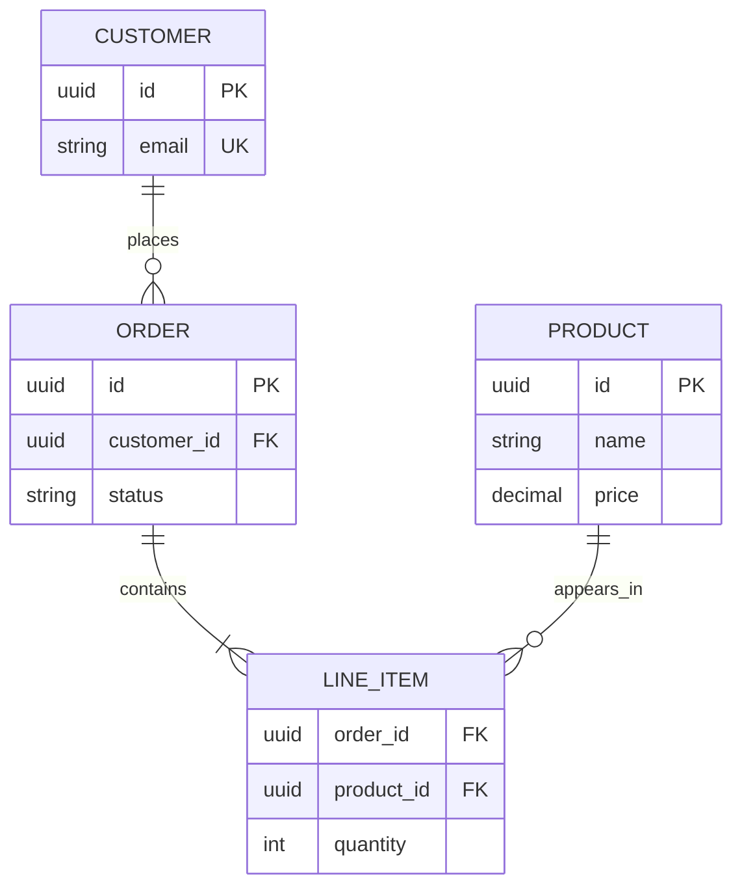
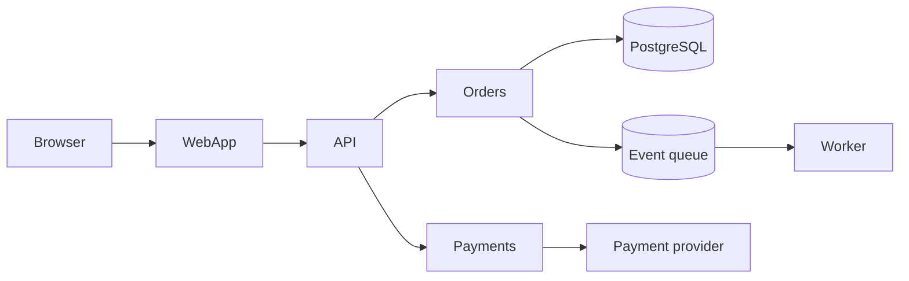
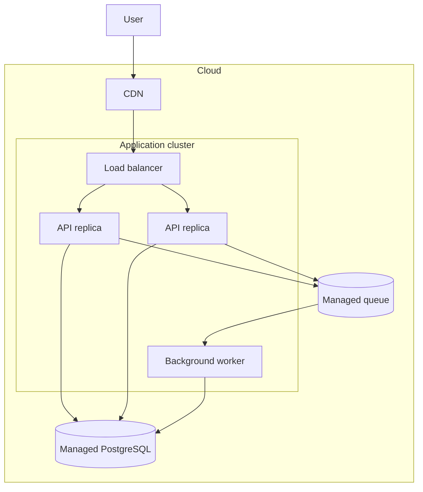

# Mermaid diagram types

Choose the diagram whose structure answers the user's question with the fewest nodes and edges. Keep labels concrete,
omit unrelated implementation detail, and prefer one focused diagram over a comprehensive map.

| Question                                              | Diagram                            |
| ----------------------------------------------------- | ---------------------------------- |
| What happens, including decisions and parallel paths? | Flowchart or activity diagram      |
| Which states exist and what causes transitions?       | State diagram                      |
| How do code or domain types relate?                   | Class or domain model              |
| How do persisted entities relate?                     | Entity-relationship diagram        |
| Which modules or services depend on each other?       | Architecture or dependency diagram |
| Where do runtime components execute?                  | Deployment diagram                 |

## Flowchart or activity diagram

Use for workflows, algorithms with branches, and parallel activities. Name decisions as questions and label outgoing
edges with their conditions.

## State diagram

Use for lifecycle states and event-driven transitions. Show initial and terminal states when they matter; label each
transition with the event or condition that causes it.

## Class or domain model

Use for types, ownership, cardinality, and inheritance. Include only members needed to explain the relationship under
discussion.

## Entity-relationship diagram

Use for persisted data, keys, and cardinality. Distinguish it from a class diagram: model storage entities and database
relationships rather than runtime behavior.

## Architecture or dependency diagram

Use for service, package, or module boundaries and their directional dependencies. Group nodes only when the boundary
changes ownership, trust, or responsibility.

## Deployment diagram

Use for runtime placement, infrastructure boundaries, replicas, and managed dependencies. Show logical architecture
instead when physical placement is irrelevant to the question.

